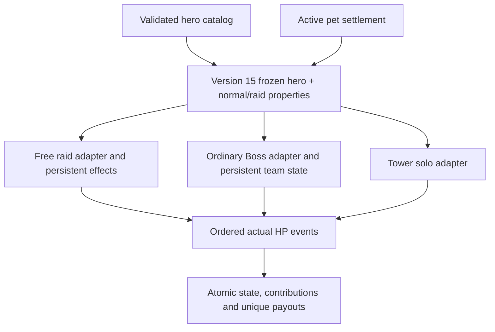

# V1.5 normal/raid and persistence contract

Base: d077dd2a2c29ad420b138bf07af23c77f4674d0b. Normative source: master's R01–R20, 23 October 2026.

Each hero accepts `passives.normal` and `passives.raid`, each an object with `key`, optional `configured` and JSON `params`. Missing normal maps to the existing passive key; missing raid becomes `{key:none,configured:false}`. No normal passive executes in raids by fallback. Catalog sync stores the contract and new battles freeze it. Existing battle snapshots keep their original version.

Base attack/copies/stars are normalized once before equipment. Duplicate Echoes scales catalog base first; Mythic stars never scale attack. Ordinary percentage buffs add in basis points. Elemental overlays retain the original physical/magic damage type and choose the highest matching elemental multiplier. Every separate HP event clamps to remaining HP. Triggering attacker receives extra damage, except Earth's separately attributed event. Recursive extra attacks are forbidden.

Transactions own state, HP, history, operation keys and ledger together. Universal Mythic currency is separate from legacy hero-specific fragments. Legacy tables remain readable and nonzero balances block removal/automatic conversion. No live database is opened by checks.

Provisional policies and unavailable content are listed in IMPLEMENTATION_STATUS.md; no server deployment is authorized.

## Будущее авторское raid-свойство обычного героя

В heroes rarity JSON автор задаёт `passives.normal.key` (согласованный с legacy `passive_key`) и независимый `passives.raid.key`. Реализацию raid помещает в запись этого ключа в hero_abilities/abilities.json в объект `raid: {effects:[...]}`. Normal effects и raid effects не смешиваются. `freeze_hero` захватывает определения обоих режимов; изменение registry после начала боя не меняет их. Legacy passive_key остаётся источником normal для старых DB-инструментов; raid из него не выводится.

Строгий расширяемый raid-контракт (`mythic/raid/contracts.py`): `damage_bonus_bps` / attack / integer value; `flat_damage` / attack / integer value; `current_hp_percent` и `original_hp_percent` / after_attack / percent 0–100; `shadow_extraction` / victory / chance_percent 0–100. Поля/типы/trigger проверяются, неизвестные эффекты отклоняются. Сложные новые stateful эффекты нужно добавить как отдельный обработчик с версией состояния и тестом, не описывать исполняемым кодом в JSON. Восемь утверждённых Mythic raid families имеют отдельный чистый reducer `raid/effects.py` и сохранённый runtime.

Тестовый пример: `RaidMatrix.test_explicit_ordinary_raid_contract_no_normal_leak` (только tests). Реальные неописанные raid-свойства обычных героев не изобретались. `params` зарезервирован как JSON-конфигурация, не исполняется; текущие числовые поля effect задаются в явном raid definition.

У special HP-события — actor_id, kind, requested, actual_hp_damage, hp_before, hp_after. Вклад учитывает actual, не requested. Целочисленный floor выполняется на событии, после него следующий эффект видит обновлённое HP. Контрстихии добавляются отдельным overlay, физический damage_type не заменяется. При нехватке диапазона SQLite операция отклоняется транзакционно, скрытый игровой cap не вводится.

Для обычного Boss необязательная `ability_config.element_multipliers` — проверяемая карта восьми стихий в integer percent; она замораживается вместе с конфигурацией. Реальные дополнительные слабости в 14 игровых шаблонов не придумывались. Из подходящих overlays применяется один наибольший множитель, при отсутствии совпадений — 100%.
