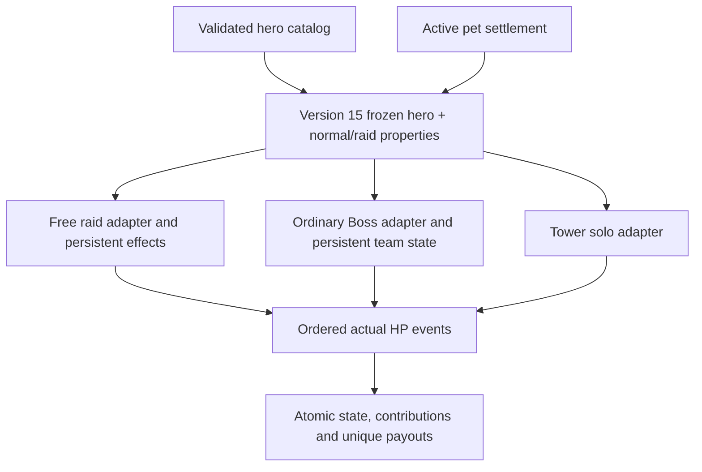

# V1.5 normal/raid and persistence contract

Base: d077dd2a2c29ad420b138bf07af23c77f4674d0b. Normative source: master's R01–R20, 23 October 2026.

Each hero accepts `passives.normal` and `passives.raid`, each an object with `key`, optional `configured` and JSON `params`. Missing normal maps to the existing passive key; missing raid becomes `{key:none,configured:false}`. No normal passive executes in raids by fallback. Catalog sync stores the contract and new battles freeze it. Existing battle snapshots keep their original version.

Base attack/copies/stars are normalized once before equipment. Duplicate Echoes scales catalog base first; Mythic stars never scale attack. Ordinary percentage buffs add in basis points. Elemental overlays retain the original physical/magic damage type and choose the highest matching elemental multiplier. Every separate HP event clamps to remaining HP. Triggering attacker receives extra damage, except Earth's separately attributed event. Recursive extra attacks are forbidden.

Transactions own state, HP, history, operation keys and ledger together. Universal Mythic currency is separate from legacy hero-specific fragments. Legacy tables remain readable and nonzero balances block removal/automatic conversion. No live database is opened by checks.

Approved O01–O10 policies and unavailable author content are listed in IMPLEMENTATION_STATUS.md; no deployment is authorized.

## Будущее авторское raid-свойство обычного героя

В heroes rarity JSON автор задаёт `passives.normal.key` (согласованный с legacy `passive_key`) и независимый `passives.raid.key`. Реализацию raid помещает в запись этого ключа в hero_abilities/abilities.json в объект `raid: {effects:[...]}`. Normal effects и raid effects не смешиваются. `freeze_hero` захватывает определения обоих режимов; изменение registry после начала боя не меняет их. Legacy passive_key остаётся источником normal для старых DB-инструментов; raid из него не выводится.

Строгий расширяемый raid-контракт (`mythic/raid/contracts.py`): `damage_bonus_bps` / attack / integer value; `flat_damage` / attack / integer value; `current_hp_percent` и `original_hp_percent` / after_attack / percent 0–100; `shadow_extraction` / victory / chance_percent 0–100. Поля/типы/trigger проверяются, неизвестные эффекты отклоняются. Сложные новые stateful эффекты нужно добавить как отдельный обработчик с версией состояния и тестом, не описывать исполняемым кодом в JSON. Восемь утверждённых Mythic raid families имеют отдельный чистый reducer `raid/effects.py` и сохранённый runtime.

Тестовый пример: `RaidMatrix.test_explicit_ordinary_raid_contract_no_normal_leak` (только tests). Реальные неописанные raid-свойства обычных героев не изобретались. `params` зарезервирован как JSON-конфигурация, не исполняется; текущие числовые поля effect задаются в явном raid definition.

У special HP-события — actor_id, kind, requested, actual_hp_damage, hp_before, hp_after. Вклад учитывает actual, не requested. Целочисленный floor выполняется на событии, после него следующий эффект видит обновлённое HP. Контрстихии добавляются отдельным overlay, физический damage_type не заменяется. При нехватке диапазона SQLite операция отклоняется транзакционно, скрытый игровой cap не вводится.

Для обычного Boss необязательная `ability_config.element_multipliers` — проверяемая карта восьми стихий в integer percent; она замораживается вместе с конфигурацией. Реальные дополнительные слабости в 14 игровых шаблонов не придумывались. Из подходящих overlays применяется один наибольший множитель, при отсутствии совпадений — 100%.

## Approved O01–O10 versioning

The source is O01_O10_APPROVED_TZ.md. New policy schema_version2/statusAPPROVED, normal_rewards.version2, star_distribution=individual,star_blessing=independent. Legacy constants remain immutable with their original PROVISIONAL label solely to reproduce saved version1 battles. Migration never rewrites saved Boss/Tower/Raid JSON.

New raids explicitly snapshot first_confirmed_counter_hero_attack_on_this_raid: matching first attack uses100% and commits counter_active/source evenactual0. A failed transaction commits nothing. Existing explicit positive-only or missing-policy snapshots keep positive-only activation. Record both saved state and an audit action once. Eclipse always increases max/current fromoriginal, saved p/gain/stars, fundbasis remainsoriginal forR09andO01.

Compensation cancellation is not victory: pool floor(ceil(M/5000)*min(D,M)/M),largest remainder/tieascendingplayer_id, no other bonus. Confirmation token binds raid/world/actor/revision/reason. Forecast reads real contributions, all payouts are pageable; reason reply matches exact privatechat/user/replymessage. Actual execution rechecks rights/revision under write lock. Replays return saved result, two admins/last hit serialize. D0/P0 refusal is audited without changing active/economy.

Star uses a durable independent decision pereligible player/Boss and perplayer/floorTower. No current-source reroll, one wallet change with persisted decision. Golden/Thief/Blessing operate on standard rewards; independent Star/passive sources remain separate. A successful Star plusBlessing means300ordinary+5mythic, not guaranteed300, not multiplied300. Tower fifth-floor chest remains once. First entry weighted arcana draw/policy persists perplayer/floor; Moon uses the same draw on later attempt, freezing Moon level on first Moon entry. Non-Moon does not gain Moon properties by itself.

Tower shield order: full cancellation(SoulSeal/Sun/etc)→Ice→Lunar→3ordinary. Existing decoy/save and trait guards retain their standard-shield hook; no event consumes two sources. New attempts preserve SoulSeal; old saved state stays unchanged. Actual zero cannot activate on-hit/Arise/side rewards. Allowed extra/class hooks remain nonrecursive. Explicit typed Shadow links are allowed by Tower catalog only for real existing Shadow targets.

Pets have an explicit manual reserve action in addition to activation swaps. Settle at deactivation, freeze active seconds/growth/mood/protection/CD in reserve/inventory; activation resumes without resetting. No paid egg before starter or ninth element, no automatic activation, all costs via universal ledger. Adult unlock waits in evolution_pending for real content.

Stories and all otherR01–R20 contracts remain. Real resources are not supplied at this stage. Strict content distinguishes missingexit2,invalidexit1,completeexit0 and does not weaken live catalog validation; all synthetic complete fixtures are temporary.
